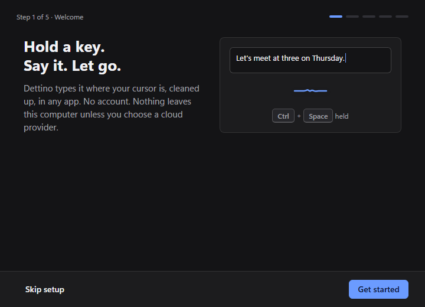
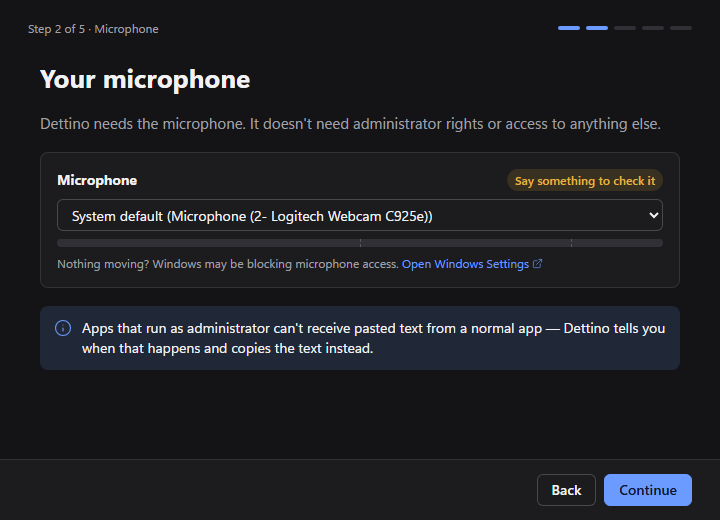
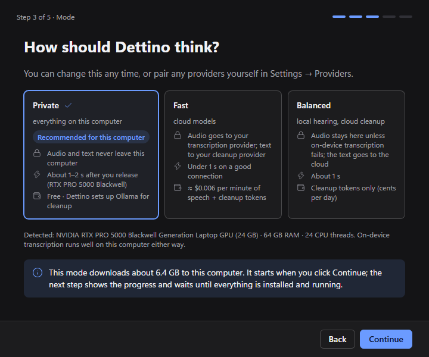
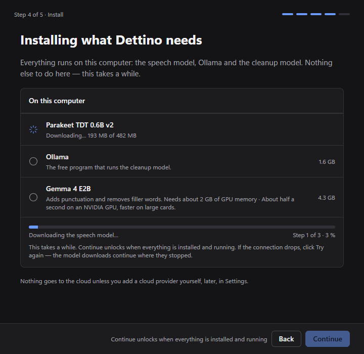
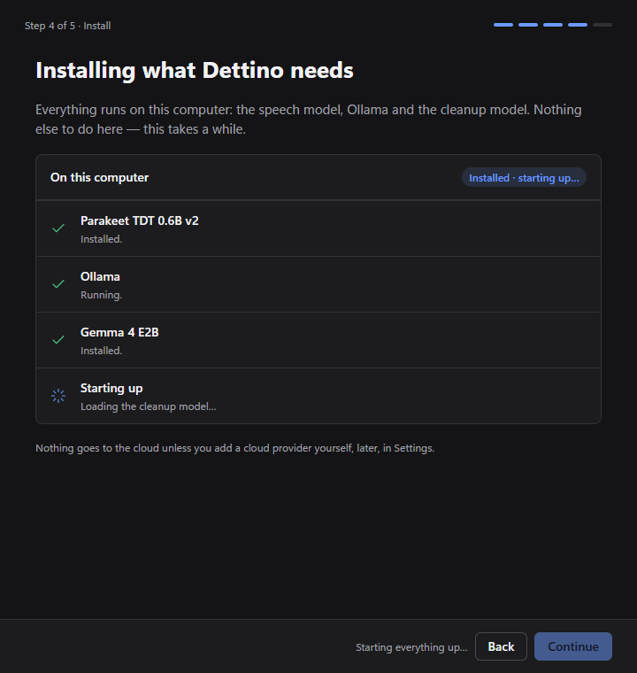
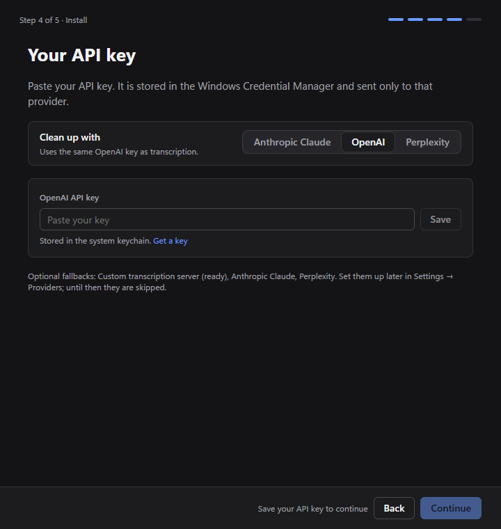
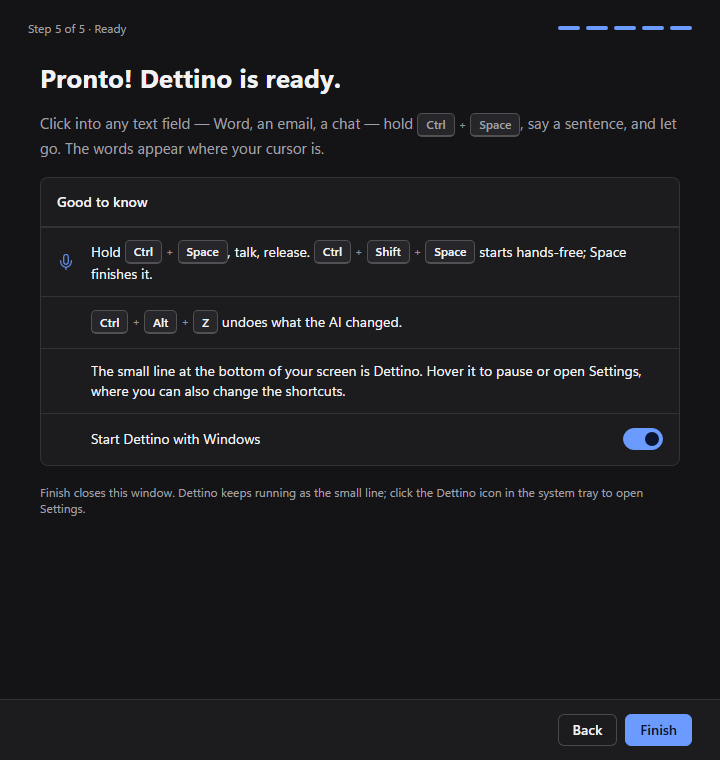
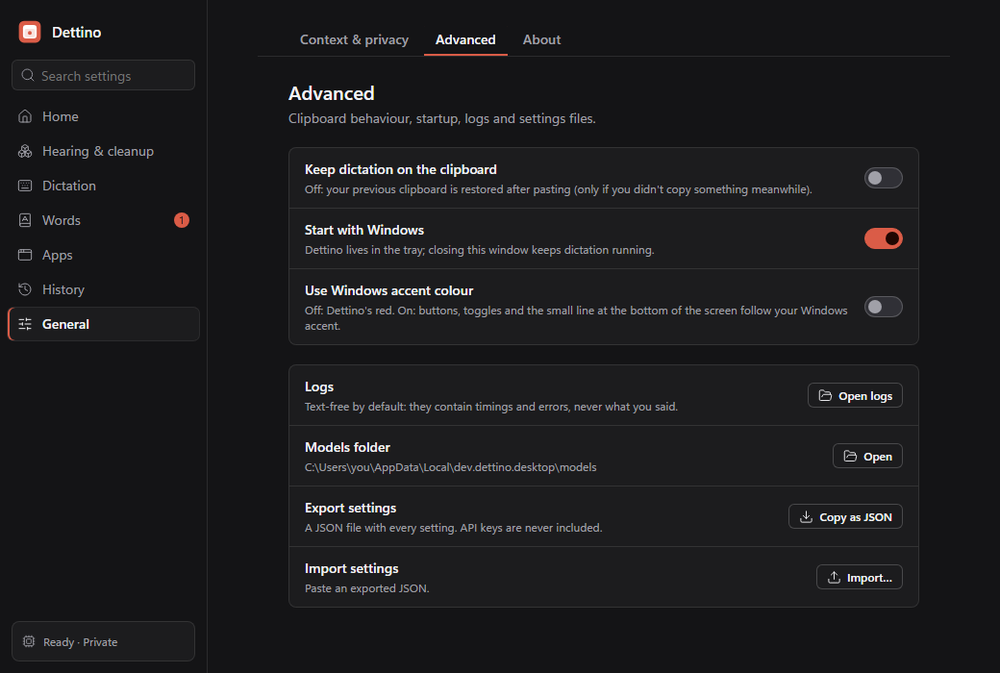

# Dettino setup guide

Dettino lets you type by talking. Hold a key, say a sentence, let go, and the words appear where your cursor is, in any program. Nothing leaves your computer unless you choose the cloud option. There is no account to create.

This guide takes you from the setup file to your first dictation. Follow it from the top; each step says what you should see before you go on. Expect about 20 minutes, most of it waiting for downloads.

> **Mac:** Dettino runs on Windows today. A Mac version is planned, and this guide will get a Mac chapter when it exists.

## 0. Before you start

You need:

- A Windows 11 PC (Windows 10 should work but is untested).
- A microphone. The one built into a laptop is fine to start with.
- The setup file from the [Releases page](https://github.com/hubertmk/dettino/releases), named like `Dettino_0.2.0_x64-setup.exe` (the number is the version; yours may be higher). Save it somewhere you can find again, for example the Downloads folder.
- About 11 GB of free disk space for the Private path, or an OpenAI account for the Cloud path. Dettino warns you before it starts if there is not enough room.
- Dettino listens in English for now.

### Check your PC (one minute)

Two facts decide how fast Private mode is on your computer. Dettino detects them itself and shows a recommendation, so this is only so you know what to expect.

1. **Memory (RAM):** press the Windows key, type `About`, open *About your PC*. Look for *Installed RAM*.
2. **Graphics card:** press Ctrl+Shift+Esc to open Task Manager, click *Performance* on the left, and look for an entry called *GPU*. If it says *NVIDIA*, you have a graphics card Dettino can use for faster cleanup.

| What you have | What to expect in Private mode |
|---|---|
| NVIDIA graphics card | Fast. Cleanup takes about half a second. |
| No NVIDIA card, 16 GB of RAM or more | Fine. Cleanup takes a few seconds per sentence. |
| No NVIDIA card, less than 16 GB | Works, but cleanup can take several seconds. If that annoys you, use Cloud mode. |

## 1. Choose your path

Dettino can run entirely on your computer, or use OpenAI's servers. You choose once during setup and can switch any time later.

| | **Private** | **Cloud** |
|---|---|---|
| Where your voice goes | Stays on this computer | To OpenAI (transcription and cleanup) |
| Cost | Free | A few cents per day of normal use (roughly $0.006 per minute of speech plus a little for cleanup) |
| Speed | 1 to 3 seconds after you let go, depending on your PC | Under a second on a good connection |
| Setup | Three downloads (about 6.5 GB: speech model, Ollama, cleanup model), handled by Dettino | An OpenAI account with a payment method and one key to paste |
| Works offline | Yes | No |

Not sure? Take **Private**. Chapters 2 and 3 apply to both paths; chapter 4 has a section for each.

## 2. Install Dettino

1. Double-click the setup file (`Dettino_0.2.0_x64-setup.exe` or similar).
2. Windows may show a blue box titled **Windows protected your PC**. It appears because Dettino is a small program that has not bought a code-signing certificate yet, not because anything is wrong with the file. Click **More info**, then **Run anyway**. (If the box does not appear, for example because the file came on a USB stick, just go on.)

   The box looks like this: a blue panel, the words *Windows protected your PC*, a short explanation, and only a *Don't run* button until you click the small *More info* link. After that a *Run anyway* button appears.

3. The installer runs for your user only, so Windows does not ask for an administrator password. Click **Next**, leave the folder as suggested, and click **Install**. Copying the files takes a few seconds; the installer moves on to its last page by itself.
4. The last page has two ticked boxes, **Run Dettino** and **Create desktop shortcut**. Leave both ticked and click **Finish**.

You should now see two things: a setup window whose first page says *Hold a key. Say it. Let go.*, and a short grey line near the bottom edge of your screen. The line is Dettino; it stays there while Dettino runs.

Click **Get started**.

## 3. The setup wizard

The wizard has five steps. *Continue* moves on and *Back* goes back; pressing Enter also continues. Only the first page has a *Skip setup* button; the other steps wait until they are done. In step 4, *Continue* stays grey until everything is downloaded, installed and running (Private) or your key is saved (Cloud). On the Private path the wizard moves on by itself once everything runs.

### Step 2 of 5: Your microphone

1. If you have more than one microphone, pick the one you want in the list. A USB headset or desk microphone beats the laptop's built-in one; a Bluetooth headset works but may swallow the first word.
2. Say something. The level bar should move and the chip at the top right should change to **Working**.

**Nothing moves?** Windows may be blocking microphone access for apps. Click **Open Windows Settings** in the step (it opens *Privacy & security → Microphone*), switch on *Microphone access* and *Let apps access your microphone*, then come back.

### Step 3 of 5: How should Dettino think?

Three cards: Private, Cloud, Balanced. **Private is already selected** and carries a *Recommended for this computer* label. Under the cards Dettino lists what it detected (graphics card, RAM, processor).

- Private path: leave it and click **Continue**. A blue note says how much Dettino downloads (about 6.4 GB on a new PC); the downloads start when you click *Continue*, and the next step shows the progress and waits until everything is installed and running.
- Cloud path: click the **Cloud** card, then **Continue**.

(Balanced keeps your voice on the computer and sends only the text to the cloud. It needs an Anthropic key and is not covered here.)

### Step 4 of 5: Installing what Dettino needs

This step differs by path.

#### Private path

The card *On this computer* lists the three things Private mode needs:

| Part | Download | What it does |
|---|---|---|
| Parakeet TDT 0.6B v2 | 482 MB | Turns your voice into text. |
| Ollama | 1.6 GB | The free program that runs the cleanup model. |
| Gemma 4 E2B | 4.3 GB | The cleanup model: turns "um so let's meet at two actually three" into "Let's meet at three." It needs about 2.5 GB of memory. |

The downloads start by themselves when you arrive. One bar shows the progress of the whole setup, and the line under it says what is happening: *Downloading the speech model*, *Unpacking the speech model…*, *Downloading Ollama*, *Installing Ollama…*, *Starting Ollama…*, *Downloading the cleanup model*. While Ollama installs, the bar shows moving stripes instead of a number; nothing else pops up. On a typical connection the whole step takes 10 to 30 minutes. Leave the window open; if you close it, Dettino keeps installing in the background and the Dettino icon in the system tray brings the window back.

The row Dettino is working on shows a small spinner and what it is doing, for example *Downloading… 193 MB of 482 MB*; the rows still waiting show an empty circle and their size. Each part gets a green tick and says *Installed.* (Ollama: *Running.*) when it is done. A last row, **Starting up**, then loads the speech model and the cleanup model and checks that Ollama answers; this takes a few seconds, up to a minute on a slow PC. When it turns green too, the card says **Installed and running** and the wizard moves on to the last step by itself.

If a download fails (for example the connection drops), the card shows the reason and a **Try again** button; the model downloads continue where they stopped, the Ollama installer starts over. If Ollama itself won't install, the card also links to the Ollama download page: install it by hand, and the card notices as soon as Ollama is running.

If the *Starting up* row reports a problem instead (for example *The cleanup model didn't answer*), click **Try again**. Should it keep failing, *Continue* still works: dictation then pastes what it heard, without cleanup, and Settings → *Hearing & cleanup* has the fix.

If your PC has no NVIDIA card and little RAM, a yellow note tells you cleanup will take a few seconds. Dettino waits for it and says so above the line while it does.

#### Cloud path

**A. Get an OpenAI key.** Do this in your web browser:

1. Go to `https://platform.openai.com` and sign up (or sign in). This is OpenAI's developer site; a ChatGPT subscription is *not* the same thing and does not cover it.
2. Open *Settings → Billing* (left menu) and click **Add payment details**. Add a card and buy a small amount of credit, for example $10. Dettino uses cents per day, so this lasts a long time.
3. Open *API keys* (left menu) and click **Create new secret key**. Give it a name such as `Dettino`, click *Create*, then **Copy**. The key starts with `sk-` and is shown only once. If you lose it, create another one.

**B. Paste the key in Dettino.**

1. In the *Clean up with* row choose **OpenAI**, so one key covers both hearing and cleanup.
2. Paste the key into the **OpenAI API key** field. Dettino checks it and shows **Saved** with the response time. If it says the key was rejected, copy it again from the OpenAI page.

The key is stored in Windows' own credential store, not in a file, and is sent only to OpenAI.

Click **Continue**.

### Step 5 of 5: Pronto! Dettino is ready.

The last page sums up how to dictate and has the **Start Dettino with Windows** switch. Leave it switched on, so the line is there after every restart.

These are the shortcuts; you will use mainly the first one. To change one later, open Settings → *Dictation*, click it and press the new keys.

| Action | Keys |
|---|---|
| Hold to talk | Ctrl + Space |
| Hands-free (start, then speak as long as you like) | Ctrl + Shift + Space |
| Edit selected text by voice | Ctrl + Alt + Space |
| Undo what the AI changed | Ctrl + Alt + Z |
| Paste the last dictation again | Ctrl + Alt + V |

A quick tap of Ctrl+Space still does what it did before in your programs; only holding it (longer than a quarter second) starts dictation.

Click **Finish**. The window closes, the line at the bottom says *Pronto! Hold Ctrl + Space to dictate* for a moment, and Dettino keeps running as the line. To open Settings later, click the Dettino icon in the system tray (bottom right, next to the clock) or hover the line and click *Settings*.

## 4. Your first real dictation

1. Open Word, or start a new email in Outlook or Gmail. Click where the text should go.
2. Hold **Ctrl+Space**. The line turns red, grows a little and moves with your voice: Dettino is listening.

   

3. Speak a full sentence or two, then let go.
4. The line turns grey again and a small bump glides along it while Dettino works (after a second it also says `Working…`). Then it flashes green, and the text is in your document.

   

That is all there is to it. It works the same in any program: the browser, Word, Outlook, WhatsApp Desktop, Notepad.

If nothing appears, open Notepad and try there first; it is the simplest case. Then see chapter 7.

## 5. Everyday use

- **Hold Ctrl+Space, talk, release.** Short sentences work best. Say punctuation if you like ("comma", "period", "new paragraph"), and say "first…, second…, third…" or "bullet point…" to get a list; Dettino adds the obvious punctuation itself.
- **Undo the cleanup:** if Dettino rewrote more than you wanted, press **Ctrl+Alt+Z** within a minute and you get exactly what you said instead.
- **Long dictation:** press **Ctrl+Shift+Space** once, talk as long as you like (up to 20 minutes), press **Space** to finish or **Esc** to throw it away.
- **The line:** hover it (or click it) to see four buttons above it: *Pause*, *Undo*, *Paste last*, *Settings*. Drag it somewhere else if it is in the way. The Dettino icon in the system tray (bottom right, next to the clock) has the same actions and more.
- **"Pasted as heard — AI skipped":** the cleanup would have changed too much, so Dettino pasted the raw words. Nothing is lost.
- **Names and special words:** if Dettino keeps mishearing a name, open Settings → *Words* and add it. Dettino also suggests words it noticed you correcting.
- **Pause:** hover the line and click *Pause*, or right-click the Dettino icon in the system tray and choose *Pause dictation*. Click the line again to resume.
- **Settings:** hover the line and click *Settings*, or click the Dettino icon in the system tray.

## 6. Microphone tips

- **Built-in laptop mic:** sit within arm's length and speak normally. Fan noise and typing while you talk make it worse.
- **USB headset or desk mic:** pick it in Settings → *Dictation → Audio* if Dettino chose another one. *Prefer wired or built-in over Bluetooth* is on by default.
- **Bluetooth headset (AirPods etc.):** works, but the first word may be clipped while the headset wakes up. Start talking half a second after you press the keys.

## 7. When something does not work

| What you see | What to do |
|---|---|
| Nothing happens when you hold Ctrl+Space | Click into the program you want to type in first; the shortcut is ignored while Dettino's own window is in front. Check Dettino is not paused (hover the line; it says *Paused* if it is). |
| `No microphone found` | Plug the microphone in or pick another one in Settings → *Dictation → Audio*. |
| `Can't hear you — check …` | The microphone is connected but silent. Check it is not muted (many headsets have a mute switch) and pick the right one. Also open Windows *Settings → Privacy & security → Microphone* and make sure *Microphone access* and *Let desktop apps access your microphone* are both on. |
| `Didn't hear anything` | You let go before speaking, or spoke too softly. Try again. |
| `Kept your text` with a *Paste* button | The cursor moved before Dettino could paste. Click where the text belongs and press *Paste*, or Ctrl+Alt+V. |
| `Can't type into … (runs as admin)` | That program runs as administrator and Windows blocks pasting into it. The text is on your clipboard: press Ctrl+V. |
| `Waiting for the local model…` | Cleanup on your PC is slow. Dettino will paste when it is done. If this happens every time, switch to Cloud mode (Settings → *Hearing & cleanup*). |
| `OpenAI rejected the key` (Cloud) | The key is wrong or was deleted. Create a new one at platform.openai.com and paste it in Settings → *Hearing & cleanup* → OpenAI → *Configure*. |
| `Couldn't reach OpenAI` (Cloud) | You are offline or OpenAI is down. Your words are kept in *History*; retry from there later. |
| `Brewing the espresso…` on the pill after switching on the PC | Dettino is starting Ollama and loading its models. You can already dictate; the cleanup waits until it is ready, then the pill says *Pronto!* |
| `Ollama didn't start — pasting without AI cleanup` (amber line) | Dettino could not start Ollama. Start Ollama from the Start menu; the next dictation is cleaned up again. |
| `Ollama is not installed — pasting without AI cleanup` (amber line) | The setup was skipped, or Ollama was removed. Open Settings → *Home* and click **Run setup again**. |
| Settings → Home says *Starting up…* or *Needs attention* | Dettino is still loading its models, or one of them did not load. The *Finish setup* card on that page names the part and offers the fix. |
| Ollama card says *not running* (Private) | Click **Start Ollama** in Settings → *Hearing & cleanup* → Ollama → *Configure*, or start Ollama from the Start menu. Dettino also tries again by itself, with longer pauses in between, and notices when you start it yourself. |
| Dettino was not there after you restarted the PC | Open Settings → *Home*: if a *Finish setup* row says *Dettino won't start with Windows*, the switch under Task Manager → *Startup apps* is off. Turn it on there, or switch *Start with Windows* off and on again under Settings → *General → Advanced*. |
| `Shortcuts are not available` right after a restart | Windows was not ready for the keyboard hook; Dettino tries again for about three minutes. If the message stays, restart Dettino. |
| A download stops | Click *Download* or *Try again*; it continues where it stopped. |

### Getting help

Open an issue at <https://github.com/hubertmk/dettino/issues> and include these four things:

1. **The logs.** Open Settings → *General → Advanced* and click **Open logs**. A folder opens; right-click the newest file → *Send to → Compressed (zipped) folder*, and attach the zip. The logs contain timings and error messages, never what you said.
2. **A screenshot** of Settings → *Hearing & cleanup* (Windows key + Shift + S, drag over the window, paste into the message).
3. **What you were doing:** which program you dictated into and what Dettino showed above the line.
4. **Your version.** It is written at the bottom of the left-hand column of the Dettino window, for example *Dettino 0.2.0*. Clicking it opens *About*, where **Copy** puts the full build details on the clipboard to paste into the message.

## 8. Updating

When a newer setup file appears on the Releases page (its version number is higher than the one at the bottom left of your Dettino window):

1. Right-click the Dettino icon in the system tray (bottom right, next to the clock; click the small arrow if you don't see it) and choose **Quit**.
2. Run the new setup file the same way as in chapter 2 (the *Windows protected your PC* box appears again). The installer notices the old version and asks what to do: leave **Uninstall before installing** selected and click *Next*. The uninstaller it runs keeps your settings and Ollama (its two boxes start unticked when it runs this way).
3. Leave **Run Dettino** ticked on the last page, or start Dettino from the Start menu.

Your settings, key, downloaded models and history stay.

## 9. Uninstalling

1. Quit Dettino (right-click the Dettino icon in the system tray → **Quit**).
2. Windows *Settings → Apps → Installed apps*, find **Dettino**, click the three dots → **Uninstall**.
3. The uninstaller shows two boxes:
   - **Delete my settings, history, speech models and saved keys** is ticked. It removes Dettino's data folder (`C:\Users\<you>\AppData\Local\dev.dettino.desktop`) and the API keys saved in Windows Credential Manager. Untick it only if you plan to install Dettino again and want to keep your setup.
   - **Also remove Ollama and its AI models** appears when Ollama is installed. It is ticked if Dettino installed Ollama for you; if you had Ollama before, it is unticked. Ticked, it uninstalls Ollama and deletes its models in `C:\Users\<you>\.ollama` (several GB). This can take a minute.
4. Click **Uninstall**. Nothing of Dettino is left afterwards.
